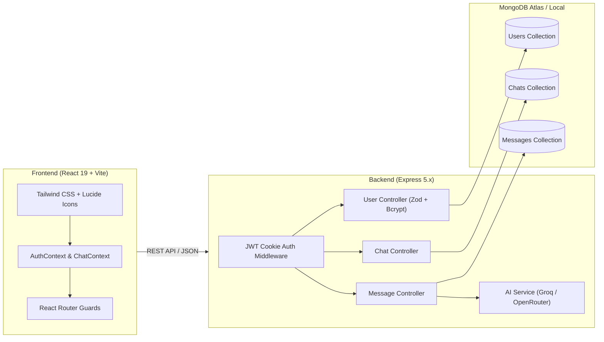

<div align="center">

# 🤖 AI Conversational Platform (ChatGPT Clone)

**A modern, full-stack conversational AI platform built for real-time intelligent conversations, session management, and seamless markdown rendering.**

[](https://react.dev/)
[](https://vitejs.dev/)
[](https://tailwindcss.com/)
[](https://nodejs.org/)
[](https://expressjs.com/)
[](https://www.mongodb.com/)
[](https://opensource.org/licenses/MIT)

[Features](#-key-features) • [Architecture](#-architecture) • [Tech Stack](#-tech-stack) • [Quick Start](#-getting-started) • [API Reference](#-api-endpoints) • [Roadmap](#-roadmap)

</div>

---

## 📖 Overview

The **AI Conversational Platform** is an end-to-end ChatGPT clone that combines an intuitive, responsive frontend with a scalable Express + MongoDB backend. It integrates with high-speed LLM inference providers (Groq / OpenRouter) to deliver lightning-fast responses, persistent multi-session chat histories, strict Zod-validated JWT authentication, and token usage tracking.

---

## ✨ Key Features

### 🧠 Intelligent Conversational Core
- **LLM-Powered Chat**: Seamless chat completions powered by state-of-the-art models (e.g. `openai/gpt-oss-20b`, `llama-3.3-70b`).
- **Context-Aware Dialogue**: Maintains a rolling window of message history for natural multi-turn conversations.
- **Smart Topic Naming**: Auto-generates clean, contextual conversation titles from the opening prompt.

### 🎨 ChatGPT-Style Sleek UI/UX
- **Dark-Themed Interface**: Modern UI styled with Tailwind CSS, inspired by OpenAI's ChatGPT.
- **Rich Markdown & Code Highlighting**: Renders GitHub Flavored Markdown (tables, blockquotes, ordered/unordered lists, code snippets).
- **One-Click Code & Response Copying**: Quickly copy AI replies to your clipboard with visual confirmation.
- **Interactive Starter Prompts**: Suggestion chips for coding, writing, brainstorming, and concept explanations.
- **Fully Responsive**: Collapsible drawer navigation tailored for both desktop and mobile screens.

### 🛡️ Authentication & User Protection
- **Secure JWT Authentication**: HTTP-only secure cookie sessions to defend against XSS and token-theft.
- **Robust Input Validation**: Strict client and server-side validation powered by **Zod** (enforcing strong passwords and sanitization).
- **Password Hashing**: Industry-standard **bcrypt** (12 salt rounds) encryption.

### ⚡ Session & Resource Management
- **Multi-Chat History**: Create, switch, and delete multiple conversations on demand.
- **Cascading Data Cleanup**: Deleting a chat automatically removes all associated message records in MongoDB.
- **Token Analytics & Limits**: Visual usage meter in the sidebar displaying token consumption against hourly limits.

---

## 🏗️ Architecture



---

## 💻 Tech Stack

| Domain | Technology | Purpose |
|---|---|---|
| **Frontend Framework** | React 19 (Vite) | Lightning-fast SPA with modern React patterns |
| **Styling** | Tailwind CSS v4 | Clean, dark-mode design with responsive layout |
| **Routing & State** | React Router v7 + Context API | Client-side routing, route guards, and shared state |
| **Markdown Engine** | `react-markdown` + `remark-gfm` | Formatted markdown, lists, and tables |
| **Backend Runtime** | Node.js + Express 5 | High-performance asynchronous API server |
| **Database** | MongoDB + Mongoose 9 | NoSQL database for flexible chat hierarchies & indexing |
| **Authentication** | JWT (`jsonwebtoken`) + `bcrypt` | Secure cookie-based authentication |
| **Validation** | Zod | Robust schema validation with customized error feedback |
| **AI Inference** | Groq / OpenRouter API | Ultra-low latency LLM generation |

---

## 📁 Project Structure

```bash
AI-Conversational-Platform/
├── Client/                      # React Frontend Application
│   ├── public/                  # Favicon and static assets
│   ├── src/
│   │   ├── components/          # UI Components
│   │   │   ├── ChatArea.jsx     # Main chat container & prompt bar
│   │   │   ├── MessageBubble.jsx# Rendered message & markdown
│   │   │   └── Sidebar.jsx      # Navigation, chat history, usage meter
│   │   ├── context/             # Global State
│   │   │   ├── AuthContext.jsx  # Login, signup, user session state
│   │   │   └── ChatContext.jsx  # Chats, message thread state & APIs
│   │   ├── pages/               # Top-level Page Views
│   │   │   ├── ChatPage.jsx     # Main protected dashboard
│   │   │   ├── LoginPage.jsx    # Login view
│   │   │   └── SignupPage.jsx   # Registration view
│   │   ├── utils/
│   │   │   └── api.js           # Axios instance with credentials & baseURL
│   │   ├── App.jsx              # Application router & route guards
│   │   └── main.jsx             # React DOM entry point
│   ├── package.json
│   └── vite.config.js           # Vite config with backend proxy
│
└── Server/                      # Express Backend Application
    ├── config/
    │   └── database.js          # MongoDB connection handler
    ├── controllers/
    │   ├── chatController.js    # Chat session CRUD logic
    │   ├── messageController.js # Message dispatch, history & token tracking
    │   └── userControllers.js   # Authentication & profile logic
    ├── middlewares/
    │   └── authUserMiddleware.js# Cookie-based JWT verification guard
    ├── model/
    │   ├── chatSchema.js        # Chat session schema
    │   ├── messageSchema.js     # Individual message records schema
    │   └── userSchema.js        # User credentials & token usage schema
    ├── routes/
    │   ├── chatRouter.js        # /chat endpoints
    │   ├── messageRouter.js     # /msg endpoints
    │   └── userRouter.js        # /user endpoints
    ├── services/
    │   └── aiService.js         # Multi-provider LLM connector
    ├── validators/
    │   └── userValidation.js    # Zod schemas for login and signup
    ├── .env                     # Server environment variables
    ├── index.js                 # Server entry point
    └── package.json
```

---

## ⚡ Getting Started

### Prerequisites

Ensure you have the following installed on your local machine:
- [Node.js](https://nodejs.org/) (v18.x or later recommended)
- [npm](https://www.npmjs.com/) or [pnpm](https://pnpm.io/)
- A [MongoDB](https://www.mongodb.com/) instance (Local installation or MongoDB Atlas URI)
- An API Key from [Groq Console](https://console.groq.com/) or [OpenRouter](https://openrouter.ai/)

---

### Installation & Setup

#### 1. Clone the Repository
```bash
git clone https://github.com/kaushiklalit01/AI-Conversational-Platform.git
cd AI-Conversational-Platform
```

#### 2. Configure Backend Environment
Navigate into the `Server` directory and create or update `.env`:
```bash
cd Server
```

Create a `.env` file with the following variables:
```env
# AI Provider (Groq API key starts with 'gsk_', OpenRouter with 'sk-or-')
OPEN_ROUTER_API_KEY=your_groq_or_openrouter_api_key

# MongoDB Connection String (Atlas or Local)
MONGO_URL=mongodb+srv://<username>:<password>@cluster.mongodb.net/chatgpt

# Authentication & Server Settings
JWT_SECRET=your_super_secret_jwt_key_here
PORT=3000
CLIENT_URL=http://localhost:5173
```

Install backend dependencies:
```bash
npm install
```

Start the backend server:
```bash
node index.js
```
*(Server will start listening at `http://localhost:3000`)*

---

#### 3. Setup and Run the Frontend
Open a new terminal window and navigate to `Client`:
```bash
cd Client
npm install
npm run dev
```

The frontend will be available at **`http://localhost:5173/`**.

---

## 📡 API Endpoints

### 👤 User Endpoints (`/user`)
| Method | Endpoint | Auth Required | Description |
|---|---|---|---|
| `POST` | `/user/signup` | No | Register new user account (Zod validated) |
| `POST` | `/user/login` | No | Authenticate user & attach JWT cookie |
| `POST` | `/user/logout` | No | Invalidate and clear auth cookie |
| `GET` | `/user/profile` | **Yes** | Fetch current authenticated user & token metrics |

### 💬 Chat Endpoints (`/chat`)
| Method | Endpoint | Auth Required | Description |
|---|---|---|---|
| `POST` | `/chat/createChat` | **Yes** | Initialize a new chat session with a model |
| `GET` | `/chat/getRecentChats` | **Yes** | Fetch the user's 20 most recent chats |
| `GET` | `/chat/:chatId` | **Yes** | Get metadata for a specific chat |
| `DELETE` | `/chat/:chatId` | **Yes** | Delete chat and cascade-delete all its messages |

### ✉️ Message Endpoints (`/msg`)
| Method | Endpoint | Auth Required | Description |
|---|---|---|---|
| `POST` | `/msg/send` | **Yes** | Send user prompt, retrieve AI answer, and update counts |
| `GET` | `/msg/:chatId` | **Yes** | Load full message history for a conversation |
| `DELETE` | `/msg/:messageId` | **Yes** | Delete a specific message record |

---

## 🔒 Security Best Practices

- **HTTP-Only Cookies**: Prevents client-side scripts from reading the JWT payload via `document.cookie`.
- **Zod Data Sanitization**: Prevents malformed user registration inputs and enforces password complexity (min 6 characters, uppercase, lowercase, numeric, and symbol rules).
- **Ownership Verification**: All chat and message database queries enforce matching `userId: req.user._id` to prevent unauthorized cross-tenant data access.
- **Cascading Document Cleanup**: Eliminates orphaned records when a parent conversation is purged.

---

## 🗺️ Roadmap

- [ ] **Streaming Responses (SSE)**: Implement Server-Sent Events for word-by-word streaming generation.
- [ ] **Multi-Model Selector**: Dropdown to switch between Llama 3.3, DeepSeek, Claude, and Mistral.
- [ ] **File & Code Attachment**: Upload text files or PDFs for document Q&A (RAG).
- [ ] **Chat Export**: Download conversation transcripts as Markdown or PDF.
- [ ] **Dark / Light Mode Toggle**: Customizable theme styling.

---

## 🤝 Contributing

Contributions, issues, and feature requests are welcome!

1. Fork the repository
2. Create your feature branch (`git checkout -b feature/AmazingFeature`)
3. Commit your changes (`git commit -m 'Add some AmazingFeature'`)
4. Push to the branch (`git push origin feature/AmazingFeature`)
5. Open a Pull Request

---

## 📄 License

This project is licensed under the **MIT License** - see the [LICENSE](LICENSE) file for details.

---

<div align="center">
Made with ❤️ by <a href="https://github.com/kaushiklalit01">Lalit Kaushik</a>
</div>
